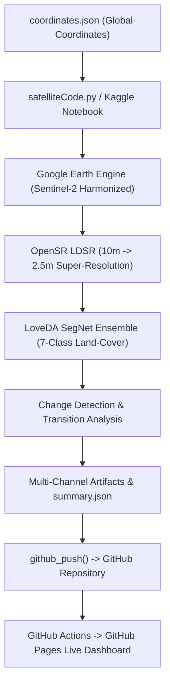

# World Satellite Monitor 🛰️🌍

**Global AI Earth Observation & Multi-Class Land-Cover Intelligence**  
A high-performance 3D Earth observation mission dashboard combining Sentinel-2 and Landsat imagery, deep learning super-resolution (OpenSR LDSR 2.5m), and 7-class land-cover segmentation.

---

## 🌟 Highlights

- **3D Photorealistic Satellite Globe**: Full-planet 4K NASA Blue Marble satellite Earth with atmospheric scattering, global borders, and smooth flight controls.
- **Real-Time Satellite Constellation Tracker**: Mathematical Keplerian orbital engine tracking Sentinel-2A/B and Landsat-8/9 in real-time with 3D orbit rings and telemetry HUD cards.
- **7-Class AI Land-Cover Classification**: Tracks urban expansion (Buildings & Roads), water body shifts, deforestation/afforestation (Forest loss & gain), and agricultural dynamics.
- **Interactive Temporal Comparison**: Modern split-view before/after comparison slider, multi-year animated GIF timelapses, and 5-panel diagnostic sheets.
- **Autonomous Pipeline**: Kaggle notebook auto-runs weekly, pulls Sentinel-2 bands via Google Earth Engine, runs deep learning inference, updates metadata, and pushes directly to GitHub.

---

## 🏗️ Architecture



---

## 📂 Repository Structure

```
world-satellite-monitor/
├── .github/workflows/deploy.yml   # GitHub Actions automated Pages build & deployment
├── coordinates/                   # Generated temporal satellite tiles & diagnostic masks
├── docs/                          # Architecture guides & documentation
├── frontend/                      # Standalone React 19 + Three.js + Vite Web Application
│   ├── public/                    # 4K Earth textures, icons & local assets
│   ├── src/                       # Components, Three.js globe shaders, orbit engine
│   ├── package.json
│   └── vite.config.js
├── coordinates.json               # Target coordinates & monitoring registry
├── last_run.json                  # Global pipeline run summary & latest metrics
├── satelliteCode.py               # Standalone GEE + OpenSR + SegNet Python pipeline
└── world-satellite-monitor.ipynb  # Interactive Kaggle notebook for scheduled runs
```

---

## 🚀 Quick Start

### 1. Run the Frontend Locally

```bash
# Clone the repository
git clone https://github.com/Rebuild-It-Labs/world-satellite-monitor.git
cd world-satellite-monitor/frontend

# Install dependencies
npm install

# Start Vite dev server
npm run dev
```

### 2. Build for Production

```bash
cd frontend
npm run build
npm run preview
```

---

## 🛰️ Automated Kaggle Pipeline

Run [`satelliteCode.py`](./satelliteCode.py) or [`world-satellite-monitor.ipynb`](./world-satellite-monitor.ipynb) in Kaggle with the following Kaggle secrets:

| Secret Name       | Description                                          |
| ----------------- | ---------------------------------------------------- |
| `GEE_KEY`         | Google Earth Engine Service Account JSON credentials |
| `GITHUB_TOKEN`    | Personal Access Token with repo write scope          |
| `GITHUB_USERNAME` | Your GitHub username                                 |
| `GITHUB_EMAIL`    | Your GitHub email                                    |
| `KAGGLE_USERNAME` | Your Kaggle username                                 |
| `KAGGLE_KEY`      | Your Kaggle API key                                  |

---

## 📄 License

MIT License. Developed for global Earth observation and environmental monitoring.
