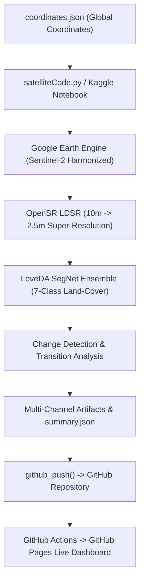

# World Satellite Monitor 🛰️🌍

**Global AI Earth Observation & Multi-Class Land-Cover Intelligence**  
A high-performance 3D Earth observation mission dashboard combining Sentinel-2 and Landsat imagery, deep learning super-resolution (OpenSR LDSR 2.5m), and 7-class land-cover segmentation.

---

## 🌟 Highlights

- **3D Photorealistic Satellite Globe**: Full-planet 4K NASA Blue Marble satellite Earth with atmospheric scattering, global borders, and smooth flight controls.
- **Real-Time Satellite Constellation Tracker**: Mathematical Keplerian orbital engine tracking Sentinel-2A/B and Landsat-8/9 in real-time with 3D orbit rings and telemetry HUD cards.
- **7-Class AI Land-Cover Classification**: Tracks urban expansion (Buildings & Roads), water body shifts, deforestation/afforestation (Forest loss & gain), and agricultural dynamics.
- **Interactive Temporal Comparison**: Modern split-view before/after comparison slider, multi-year animated GIF timelapses, and 5-panel diagnostic sheets.
- **Autonomous Pipeline**: Kaggle notebook auto-runs weekly, pulls Sentinel-2 bands via Google Earth Engine, runs deep learning inference, updates metadata, and pushes directly to GitHub.

---

## 🏗️ Architecture



---

## 📂 Repository Structure

```
world-satellite-monitor/
├── .github/workflows/deploy.yml   # GitHub Actions automated Pages build & deployment
├── coordinates/                   # Generated temporal satellite tiles & diagnostic masks
├── docs/                          # Architecture guides & documentation
├── frontend/                      # Standalone React 19 + Three.js + Vite Web Application
│   ├── public/                    # 4K Earth textures, icons & local assets
│   ├── src/                       # Components, Three.js globe shaders, orbit engine
│   ├── package.json
│   └── vite.config.js
├── coordinates.json               # Target coordinates & monitoring registry
├── last_run.json                  # Global pipeline run summary & latest metrics
├── satelliteCode.py               # Standalone GEE + OpenSR + SegNet Python pipeline
└── world-satellite-monitor.ipynb  # Interactive Kaggle notebook for scheduled runs
```

---

## 🚀 Quick Start

### 1. Run the Frontend Locally

```bash
# Clone the repository
git clone https://github.com/Rebuild-It-Labs/world-satellite-monitor.git
cd world-satellite-monitor/frontend

# Install dependencies
npm install

# Start Vite dev server
npm run dev
```

### 2. Build for Production

```bash
cd frontend
npm run build
npm run preview
```

---

## 🛰️ Automated Kaggle Pipeline

Run [`satelliteCode.py`](./satelliteCode.py) or [`world-satellite-monitor.ipynb`](./world-satellite-monitor.ipynb) in Kaggle with the following Kaggle secrets:

| Secret Name       | Description                                          |
| ----------------- | ---------------------------------------------------- |
| `GEE_KEY`         | Google Earth Engine Service Account JSON credentials |
| `GITHUB_TOKEN`    | Personal Access Token with repo write scope          |
| `GITHUB_USERNAME` | Your GitHub username                                 |
| `GITHUB_EMAIL`    | Your GitHub email                                    |
| `KAGGLE_USERNAME` | Your Kaggle username                                 |
| `KAGGLE_KEY`      | Your Kaggle API key                                  |

---

## 🎨 Themes Engine

World Satellite Monitor features an extensible, zero-reload multi-theme engine supporting 6 pop-culture-inspired aesthetics:

| Theme | Icon | Palette & Inspiration | Ambient Particle Effect |
| :--- | :---: | :--- | :--- |
| **Mission Control** | 🛰️ | Cyber-forest emerald (`#00ff88`), cyber cyan & HUD black | Clean deep space |
| **Harry Potter** | ⚡ | Gryffindor crimson (`#9e1b32`), parchment & antique gold (`#d4af37`) | Floating warm candle embers |
| **Dr Doom** | 👑 | Monarch armor titanium, Latverian gold & cosmic green (`#00ff77`) | Arcane green electrical sparks |
| **Spider-Man** | 🕷️ | Queens scarlet red (`#e21b24`), suit blue (`#0066cc`) & web white | Drifting spider-web strands |
| **Beauty & the Beast** | 🌹 | Midnight velvet plum (`#100619`), enchanted rose red & gilded gold | Fluttering rose petals |
| **Money Heist** | 🎭 | Royal Mint charcoal (`#0e0e0e`), Dalí jumpsuit crimson & minted gold | Falling banknotes & gold confetti |

### How It Works

1. **Pre-paint Theme Injection**: An inline script in `index.html` resolves the active theme from the `?theme=` URL parameter or `localStorage("wsm-theme")` and sets `<html data-theme="...">` before first paint, completely preventing theme flash (FOUC).
2. **CSS Variables Architecture**: Each theme exposes custom properties (`--bg`, `--surface`, `--primary`, `--secondary`, `--accent`, `--border`, `--glow`, `--globe-atmosphere`, `--globe-ocean`, `--globe-land`, `--globe-marker`).
3. **Dynamic WebGL / Three.js Integration**: The 3D Earth globe (`GlobeBase.jsx`, `CountryBorders.jsx`, `PulsarMarker.jsx`) reacts live to theme switches without reloading textures or restarting WebGL contexts.
4. **Accessible Theme Switcher**: Located in the top-right corner with thumbnail preview cards, color swatches, keyboard navigation (`Arrow keys`, `Enter`, `Esc`), WCAG AA contrast, and a particles on/off toggle.
5. **Subpath & GitHub Pages Safety**: All theme asset paths are resolved using `import.meta.env.BASE_URL` (never hardcoded absolute `/theme/...`).

### Adding a New Theme

Adding a new theme requires only three steps:

1. **Add Theme Assets** to `frontend/public/theme/<folder_name>/`:
   - `preview.webp` (600×340 px, ≤ 50 KB)
   - `bg.webp` (1920×1080 px, ≤ 300 KB)
   - `bg-mobile.webp` (828×1792 px, ≤ 150 KB)
   - `texture.webp` (256×256 px tileable, ≤ 50 KB)
   - `emblem.svg` (vector icon, ≤ 10 KB)
   - `favicon.svg` (vector favicon, ≤ 10 KB)

2. **Register the Theme** in `frontend/src/themes/themes.config.js`:
   ```javascript
   {
     id: "my-theme",
     label: "My Theme",
     icon: "✨",
     description: "Short description...",
     folder: "my_theme",
     palette: { primary: "#...", secondary: "#...", ... },
     globe: { atmosphere: "#...", ocean: "#...", land: "#...", marker: "#..." },
     effect: "candles" // 'candles' | 'energy' | 'webs' | 'petals' | 'banknotes' | 'none'
   }
   ```

3. **Define CSS Variables** in `frontend/src/themes/theme.css`:
   ```css
   :root[data-theme="my-theme"] {
     --bg: #...;
     --primary: #...;
     --surface: rgba(...);
     --border: rgba(...);
   }
   ```

---

## 📄 License

MIT License. Developed for global Earth observation and environmental monitoring.
